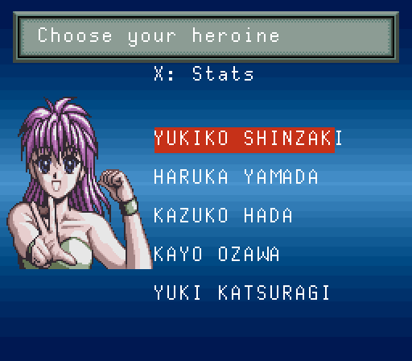
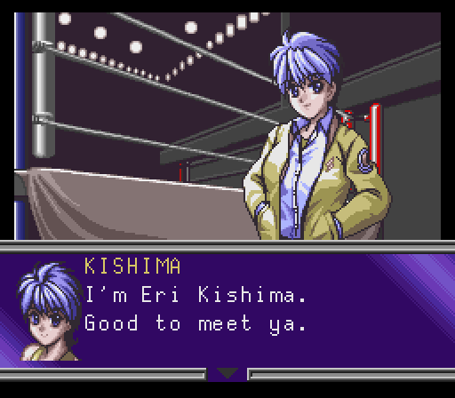
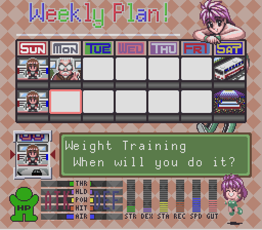
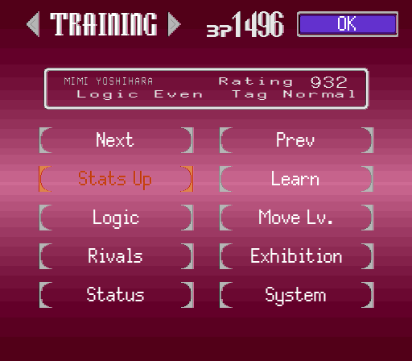
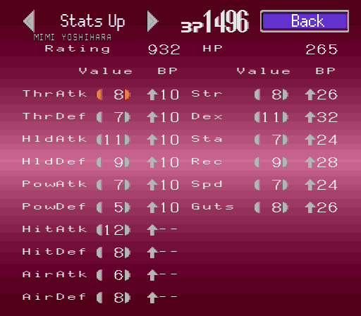
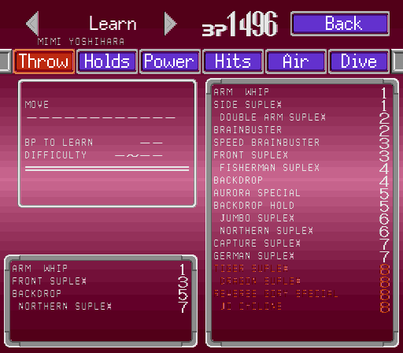
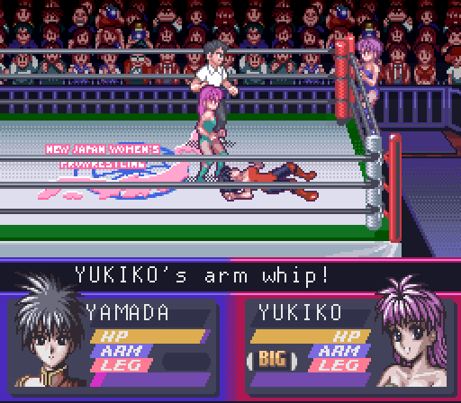
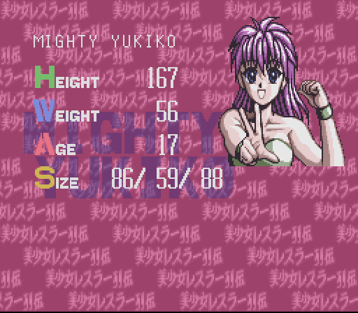

# Screenshots

Bishoujo Wrestler Retsuden: Blizzard Yuki Rannyuu!! with the English patch, taken in Mesen.

## Choosing a heroine

The five heroines' names, in the game's name font with two letters packed into each tile.

## The story

Champion Road's dialogue, in the new 8×16 font beside the speaker's face.

## The weekly plan

The schedule screen's title art, day labels and help messages.

## Training

The training hub's buttons and the wrestler's info box.

## Stats Up

Stat names and headers redrawn for the game's high-resolution screens.

## Learning moves

Move names, tabs and the learn panel.

## A match

The commentary ticker along the top of the name panels, and the strategy icons.

## Profiles

The attract-mode profiles that play on the title screen.
